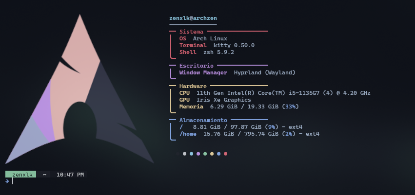

# kitty_zenxlk

Mi configuración personal de terminal: [kitty](https://sw.kovidgoyal.net/kitty/) + [fastfetch](https://github.com/fastfetch-cli/fastfetch) + [starship](https://starship.rs/), corriendo en Arch Linux + [Hyprland](https://hyprland.org/) usando [HyDE](https://github.com/HyDE-Project/HyDE).

## Capturas de pantalla



<!-- Agrega mas capturas a la carpeta screenshots/ y referenciarlas aqui -->

## Información del sistema

```
OS: Arch Linux x86_64
Kernel: Linux 7.3.5-arch1-1
Window Manager: Hyprland 0.57.2 (Wayland)
Theme: wallbash [Qt], Decay-Green [GTK2/3/4]
Icons: Tela-circle-green [Qt], Tela-circle-green [GTK2/3/4]
Font: Cantarell (10pt) [Qt], Cantarell (10pt) [GTK2/3/4]
Cursor: Bibata-Modern-Ice (24px)
Terminal: kitty
CPU: 11th Gen Intel(R) Core(TM) i5-1135G7 (8) @ 4.20 GHz
GPU: Intel Iris Xe Graphics @ 1.30 GHz [Integrada]
```

Generado con [`fastfetch`](https://github.com/fastfetch-cli/fastfetch) (cajas por sección: Sistema, Escritorio, Hardware, Almacenamiento).

## Estructura

```
.config/
├── kitty/
│   ├── kitty.conf              # Ajustes personales (barra de pestañas, transparencia, cursor...)
│   ├── hyde.conf               # Ajustes base administrados por HyDE, se regeneran al cambiar el tema
│   ├── theme.conf              # Esquema de color, generado automáticamente a partir del tema/wallpaper actual
│   └── wallbash-borders.conf   # Bordes de split — generado por el template de abajo (snapshot, no editar a mano)
├── hyde/
│   └── wallbash/always/
│       └── kitty-borders.dcol  # Template de wallbash: genera wallbash-borders.conf en cada cambio de tema/wallpaper
├── fastfetch/
│   ├── config.jsonc        # Resumen del sistema en cajas de color con logo via protocolo gráfico
│   └── logo/
│       └── archlinux.png   # (las imágenes personales/con copyright se quedan solo en local, ver .gitignore)
├── starship/
│   └── starship.toml       # Prompt de shell en bloques tipo powerline
└── zsh/
    ├── user.zsh            # Plugins de oh-my-zsh, completado y zoxide — corre ANTES de oh-my-zsh.sh
    └── .zshrc              # Alias de eza y atuin — corre DESPUES de oh-my-zsh.sh (ver nota abajo)
```

**Nota sobre HyDE y zsh:** HyDE no usa un `~/.zshrc` plano — redirige `ZDOTDIR` a `~/.config/zsh/` y cada cosa tiene su lugar fijo:
- Starship solo lee `~/.config/starship/starship.toml` (no `~/.config/starship.toml`).
- Los plugins de oh-my-zsh se declaran en `~/.config/zsh/user.zsh`, no en `~/.zshrc`.
- **Orden de carga:** `user.zsh` se sourcea *antes* que `oh-my-zsh.sh` (ver `conf.d/hyde/terminal.zsh`), así que cualquier alias o `bindkey` puesto ahí puede ser pisado por un plugin de oh-my-zsh que cargue después (por ejemplo el plugin `fzf` toma Ctrl+R). Por eso `eza` (alias `ls`) y `atuin` (que también quiere Ctrl+R) se inicializan en `.zshrc`, que corre al final.

Si tienes HyDE y algo "no se ve" o un atajo no responde como esperas, probablemente esté en el archivo equivocado — revisa `~/.config/zsh/conf.d/hyde/` para ver qué carga qué y en qué orden.

**Si los colores no coinciden con tu wallpaper:** cambiar el fondo de pantalla con una herramienta que no sea la de HyDE (por ejemplo `swww`/`hyprpaper` directo) deja la imagen visual desincronizada de lo que HyDE cree que es el tema activo, y wallbash sigue generando colores del tema viejo. Usa `hyde-shell theme.switch -s "Nombre del Tema"` (o el selector de temas de HyDE) para que wallpaper + paleta + todas las apps cambien juntos.

**Cuidado con `wallpaper --set ... --global`:** la bandera `--global` regenera las miniaturas de *todos* los temas instalados a partir del wallpaper que estés aplicando, no solo del tema actual — si la usas, las tarjetas de otros temas en el selector de HyDE (`Super+Shift+T`) quedan con la miniatura equivocada. Para corregirlo, se regenera miniatura por miniatura con `hyde-shell wallpaper --cache wall "<ruta del wallpaper del tema>"` (borrando antes el archivo cacheado en `~/.cache/hyde/thumbs/` si quedó en 0 bytes).

## Características

- Barra de pestañas estilo powerline, inclinada
- [Nerd Font](https://www.nerdfonts.com/) (CaskaydiaCove) para íconos/glifos en el prompt
- Rastro de cursor animado, cursor tipo beam con parpadeo suave
- Transparencia + blur de Hyprland en la ventana de kitty
- Bordes de split coloreados al dividir la ventana en paneles — 100% dinámicos vía un template propio de wallbash (`kitty-borders.dcol`), ya que kitty no permite referenciar los colores del tema directamente ahí (solo acepta hex literal)
- Esquema de color sincronizado automáticamente con el wallpaper del escritorio vía [decaycs](https://github.com/decaycs) — fastfetch, starship, el resaltado de sintaxis, las autosugerencias y `LS_COLORS` (completado, `ls`/`eza`) usan nombres/slots de color ANSI en vez de valores fijos, así que todo cambia junto cuando cambias de wallpaper
- `fastfetch` con el logo mostrado como imagen real (protocolo gráfico de kitty) elegido **al azar** entre lo que haya en `.config/fastfetch/logo/` — basta con dejar más PNG ahí para que el logo cambie solo; se ejecuta automáticamente al abrir una terminal nueva (vía HyDE)
- Prompt de `starship` en bloques: usuario · directorio · rama de git (si aplica) · hora, más la duración del último comando si tardó
- zsh con autosugerencias (`zsh-autosuggestions`), resaltado de sintaxis (`zsh-syntax-highlighting`) y completado de archivos/carpetas con menú interactivo + `fzf` (Ctrl+T búsqueda de archivos, `**<Tab>` para rutas)
- Plugins extra de oh-my-zsh: `git` (atajos `gst`/`gaa`/`gc`...), `extract` (descomprime cualquier archivo con `x`), `history-substring-search` (flechas filtran el historial), `you-should-use` (avisa si ya tienes un alias para lo que escribiste), `colored-man-pages`
- [`zoxide`](https://github.com/ajeetdsouza/zoxide): `cd` inteligente — `z nombre-carpeta` salta directo a tus carpetas más usadas
- [`eza`](https://github.com/eza-community/eza): reemplaza `ls`/`l`/`ll`/`lt` con íconos y colores
- [`atuin`](https://github.com/atuinsh/atuin): historial con búsqueda difusa a pantalla completa (Ctrl+R)

## Instalación

```bash
git clone https://github.com/Zenxlk/kitty_zenxlk.git
cp -r kitty_zenxlk/.config/kitty ~/.config/
cp -r kitty_zenxlk/.config/fastfetch ~/.config/
cp -r kitty_zenxlk/.config/starship ~/.config/
cp -r kitty_zenxlk/.config/zsh/. ~/.config/zsh/   # solo si usas HyDE
kitty @ load-config   # o reinicia kitty
```

Requiere `oh-my-zsh` con los plugins `zsh-autosuggestions`, `zsh-syntax-highlighting` y `you-should-use` en `~/.oh-my-zsh/custom/plugins/`, además de `fzf`, `jq`, `zoxide`, `eza`, `atuin` y `starship` instalados en el sistema.

Agrega tus propios PNG a `.config/fastfetch/logo/` para que el logo de fastfetch los elija al azar — las imágenes de este repo que no sean el logo de Arch no se publican (ver `.gitignore`), así que cada quien pone las suyas.

## Licencia

Siéntete libre de usar y adaptar cualquier parte de esta configuración.
